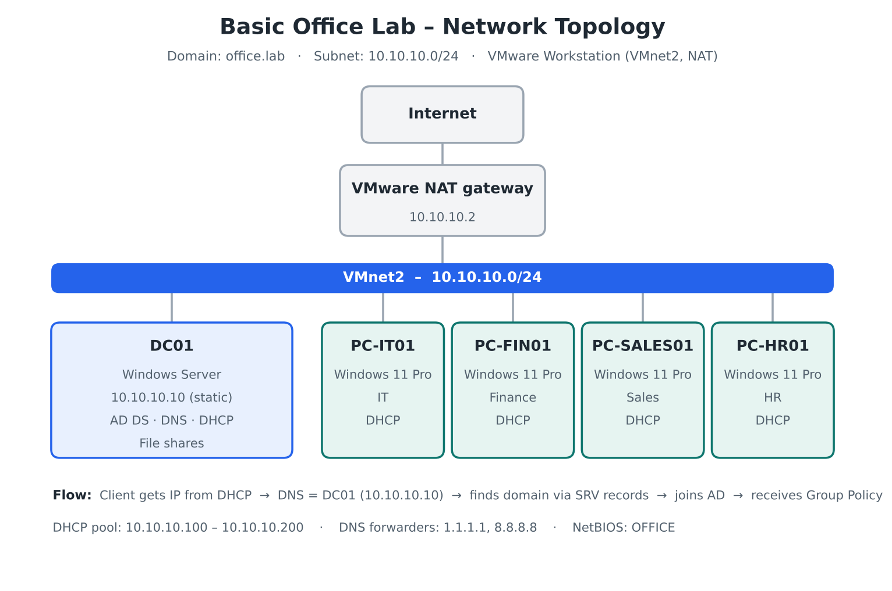

# Basic Office Lab

**Windows Server & Windows 11 office environment built in VMware**

A hands-on homelab simulating a small company network: one domain controller and four department workstations. The goal is to build, document and troubleshoot the core services every Windows-based office depends on.



---

## What this lab covers

| Area | Technologies |
|---|---|
| Virtualization | VMware Workstation, NAT network (VMnet8) with VMware DHCP disabled |
| Identity | Active Directory Domain Services (AD DS) |
| Name resolution | DNS (forward and reverse zones, forwarders, SRV records) |
| Addressing | DHCP (scope, options, AD authorization) |
| Structure | Organizational Units, users and security groups per department |
| Security | Password & lockout policy, tiered admin accounts, Protected Users, Windows LAPS, hardening GPO, audit policy |
| Compliance | PowerShell compliance report (PASS/WARN/FAIL) with remediation cycle |
| File services | SMB shares with Share and NTFS permissions |
| Automation | PowerShell scripts for OUs and bulk user creation |

## Lab environment

| Role | Hostname | OS | IP |
|---|---|---|---|
| Domain Controller (AD DS, DNS, DHCP, File) | **DC01** | Windows Server 2025 Datacenter | 10.10.10.10 (static) |
| Client – IT | **PC-IT01** | Windows 11 Enterprise | DHCP |
| Client – Finance | **PC-FIN01** | Windows 11 Enterprise | DHCP |
| Client – Sales | **PC-SALES01** | Windows 11 Enterprise | DHCP |
| Client – HR | **PC-HR01** | Windows 11 Enterprise | DHCP |

| Setting | Value |
|---|---|
| Domain | `office.lab` |
| NetBIOS name | `OFFICE` |
| Subnet | 10.10.10.0/24 |
| Gateway (VMware NAT) | 10.10.10.2 |
| DNS server | 10.10.10.10 (DC01) |
| DHCP range | 10.10.10.100 – 10.10.10.200 |

## Key design principle

> **Active Directory depends entirely on DNS.**
> Clients find the domain controller by querying DNS for SRV records. Every machine in the domain must use DC01 as its DNS server, never the home router. This is the most common reason domain joins fail.

```
Client gets IP from DHCP → receives DC01 as DNS → finds the domain via SRV records
→ joins Active Directory → receives Group Policies
```

## Documentation

| # | Phase | Status |
|---|---|---|
| 00 | [Planning](docs/00-planning.md) | ✅ |
| 01 | [VMware networking](docs/01-vmware-networking.md) | ✅ |
| 02 | [Server installation](docs/02-server-installation.md) | ✅ |
| 03 | [AD DS and domain controller promotion](docs/03-ad-ds-promotion.md) | ✅ |
| 04 | [DNS](docs/04-dns.md) | ✅ |
| 05 | [DHCP](docs/05-dhcp.md) | ✅ |
| 06 | [OUs, users and groups](docs/06-ous-users-groups.md) | ✅ |
| 07 | [Joining clients to the domain](docs/07-domain-join.md) | ✅ |
| 08 | [Security hardening & compliance](docs/08-group-policy.md) | ✅ (1 open item) |
| 09 | [File server and permissions](docs/09-file-server.md) | ⬜ |
| 10 | [Troubleshooting log](docs/10-troubleshooting-log.md) | 🔄 11 issues logged |

*Replace ⬜ with ✅ as each phase is completed.*

## Users

All four workstations are joined to `office.lab` and placed in the Workstations OU, each with a department user logged in.

| User | Department | Group | Workstation |
|---|---|---|---|
| ola.nordmann | IT | GG_IT | PC-IT01 |
| per.johansen | Finance | GG_Finance | PC-FIN01 |
| lars.larsen | Sales | GG_Sales | PC-SALES01 |
| emma.berg | HR | GG_HR | PC-HR01 |
| adm.christoffer | IT (admin) | Domain Admins, Protected Users | – |

## Security & compliance

| Control | Result |
|---|---|
| Password policy | 12+ characters, lockout after 5 attempts (default was *never*) |
| Admin accounts | Named `adm.` account in Protected Users; only 2 Domain Admins |
| Windows LAPS | Unique, rotating local admin password per PC |
| Hardening GPO | Screen lock, firewall forced on, USB blocked, LLMNR off, logon banner |
| Auditing | Account creation, deletion and lockouts logged (Event 4720/4726/4740) |
| Compliance report | First run **68 %**, findings remediated and re-measured |

## Highlights from troubleshooting

Eleven real issues were hit during the build, including a misconfigured virtual subnet, a DHCP authorization permission error, missing LAPS permissions and a Group Policy precedence conflict. Each is documented with symptom, investigation, root cause and fix in the [troubleshooting log](docs/10-troubleshooting-log.md).

## Scripts

| Script | Purpose |
|---|---|
| [`New-LabOUs.ps1`](scripts/New-LabOUs.ps1) | Creates the OU structure and department security groups |
| [`New-LabUsers.ps1`](scripts/New-LabUsers.ps1) | Bulk-creates users from [`users.csv`](scripts/users.csv) |
| [`Get-ComplianceReport.ps1`](scripts/Get-ComplianceReport.ps1) | Read-only AD compliance check with HTML report (PASS/WARN/FAIL) |

## Repository structure

```
basic-office-lab/
├── README.md
├── diagrams/        Network diagram
├── docs/            One guide per phase
├── screenshots/     Screenshots sorted by phase
└── scripts/         PowerShell automation
```

## What I learned

*Fill in when the lab is finished. 3–5 concrete takeaways, for example:*

- 
- 
- 

## Next steps

- [ ] Add a second domain controller (DC02) for redundancy
- [ ] Move file services to a dedicated member server (FS01)
- [ ] Implement AGDLP group strategy for share permissions
- [ ] Close the audit-policy remediation item
- [ ] Schedule the compliance report weekly
- [ ] Add Windows Server Update Services (WSUS)

---

*Lab environment only. No real company data or production credentials are used.*
