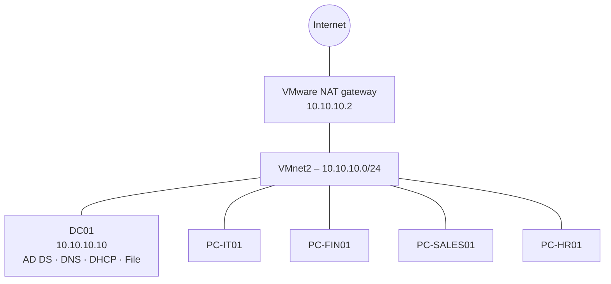

# 00 – Planning

**Goal:** Decide names, addressing and structure before building anything.

## Why plan first

Changing a domain name or IP scheme after Active Directory is installed is painful. A one-page plan prevents rework and makes every later decision easier to explain.

## Hostnames

| Role | Hostname | Reason |
|---|---|---|
| Domain Controller | DC01 | Named by function; leaves room for DC02 |
| IT workstation | PC-IT01 | Department-based naming enables per-department OUs and GPOs |
| Finance workstation | PC-FIN01 | |
| Sales workstation | PC-SALES01 | |
| HR workstation | PC-HR01 | |

All names are **15 characters or fewer** (NetBIOS limit).

## Domain name

| Setting | Value | Reason |
|---|---|---|
| FQDN | `office.lab` | Clear and short. Avoids `.local`, which conflicts with mDNS (Bonjour) |
| NetBIOS | `OFFICE` | Short name used in `OFFICE\username` logins |

> In production, use a subdomain of a domain you own, e.g. `ad.company.com`.

## IP plan

| Item | Value |
|---|---|
| Subnet | 10.10.10.0/24 |
| Gateway (VMware NAT) | 10.10.10.2 |
| DC01 | 10.10.10.10 (static) |
| Reserved for future servers | 10.10.10.11 – 10.10.10.99 |
| DHCP pool (clients) | 10.10.10.100 – 10.10.10.200 |

**Why 10.10.10.0/24:** It's unlikely to overlap with a typical home network (192.168.x.x), so routing stays predictable.

## Network diagram

## VM resources

| VM | vCPU | RAM | Disk |
|---|---|---|---|
| DC01 | 2 | 4 GB | 60 GB |
| Each client | 2 | 4 GB | 64 GB |

Host RAM needed with all VMs running: ~20 GB. With 16 GB, reduce clients to 2–3 GB or run two clients at a time.

## Screenshots to take

- [ ] Finished network diagram
- [ ] Host machine specs (optional)

## Notes

*Write down any changes to the plan here and why you made them.*
